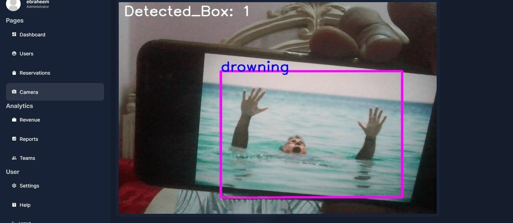
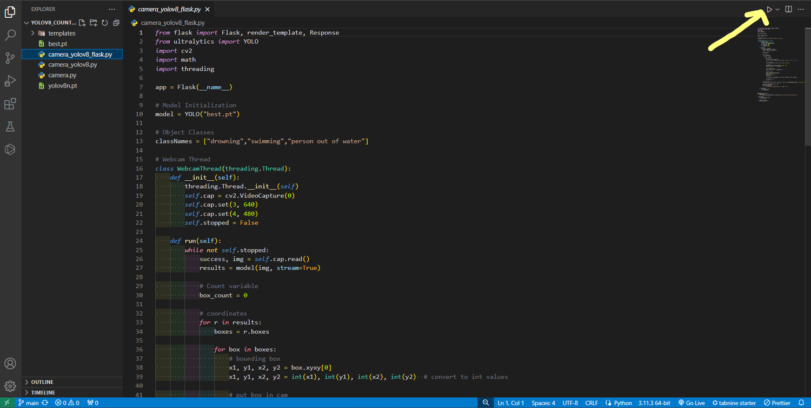

<div align="center">

# SMARTPOOL: Detection Service

**YOLOv8 computer vision for pool safety, served through Flask**


🏆 **3rd place, Google DevFest Assiut**

</div>

## Overview

This is the deep learning half of **SMARTPOOL**. It reads the webcam, runs a custom-trained YOLOv8 model (`best.pt`) on every frame, draws the detections with a live box counter, and serves the annotated video through a Flask web app so the dashboard can show it live.

<div align="center">
  
</div>

## Detected classes

| Class | Meaning |
| :-- | :-- |
| `drowning` | A swimmer showing drowning behavior |
| `swimming` | A person swimming normally |
| `person out of water` | A person outside the water |

The web dashboard is in a separate repository: **[projectgraduation](https://github.com/HosamMosstfa/projectgraduation)**.

## What's inside

| File | Purpose |
| :-- | :-- |
| `camera_yolov8_flask.py` | **Main entry point.** Loads `best.pt`, reads the webcam (640×480) in a background thread, runs YOLOv8 on each frame and streams the annotated result with Flask. |
| `camera_yolov8.py` | Runs YOLOv8 detection on the camera locally, without the web server. |
| `camera.py` | Basic camera capture script. |
| `templates/` | Flask HTML templates. |
| `best.pt` | Custom-trained YOLOv8 weights for the three classes above. |
| `yolov8n.pt` | YOLOv8 nano pretrained weights. |

## Requirements

- Python 3.8 or newer
- A webcam or camera stream
- Packages: `ultralytics`, `flask`, `opencv-python`

```bash
pip install ultralytics flask opencv-python
```

## Run it

### Option A: Terminal

```bash
git clone https://github.com/HosamMosstfa/deeplearningcodes.git
cd deeplearningcodes
python camera_yolov8_flask.py
```

Then open the address printed in the terminal. Flask uses `http://127.0.0.1:5000` unless the script sets another port.

### Option B: Anaconda + VS Code

1. Download or clone the project.
2. Open **Anaconda Navigator** and launch **Visual Studio Code**.
3. In VS Code choose **File → Open Folder** and select the project folder.
4. Open `camera_yolov8_flask.py` and click the **Run / Debug** button at the top right of the editor.



The service is now running.

## Use it with the dashboard

Start this service **first**, then run the Next.js dashboard from [projectgraduation](https://github.com/HosamMosstfa/projectgraduation) and open its camera page.

## Troubleshooting

| Problem | Fix |
| :-- | :-- |
| `ModuleNotFoundError` | Install the packages above in the same Python environment VS Code is using. |
| Camera does not open | Close other apps using the camera, or change the index in `cv2.VideoCapture(0)` (try `1`, `2`, ...). |
| Model file not found | Run the script from inside the project folder so `best.pt` is found. |

## Author

**Hossam Mostafa** · [LinkedIn](https://www.linkedin.com/in/hosammostfa) · [GitHub](https://github.com/HosamMosstfa) · hossammostafa6520@gmail.com
